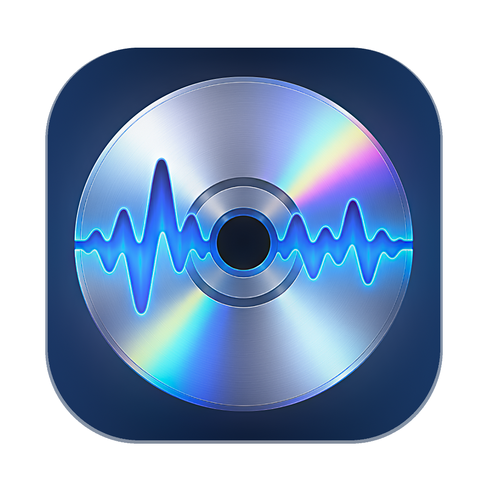

<p align="center">
  
</p>

<h1 align="center">CD Explorer</h1>

<p align="center">
  Preserve audio CDs, Enhanced CDs and their otherwise hard-to-reach data files on a modern Mac.
</p>

CD Explorer is a native macOS utility for inspecting, previewing and extracting audio CDs, Enhanced CDs, ISO images and raw IMG disc images. It combines secure audio reading, hidden-track discovery, complete data-session browsing and a careful video-conversion workflow in one self-contained application.

## Why CD Explorer exists

Commercial Enhanced CDs often contain music, videos, artwork and interactive files that are difficult to see or use on current macOS versions. Audio CDs can also hide material before Track 1 or after a long silent section inside the final track. CD Explorer exposes those areas without requiring command-line tools.

## Highlights

- Lists audio tracks separately from data-session files.
- Detects hidden track-one audio stored before the normal first track.
- Analyses hidden pre-gaps and long final tracks for substantial audio separated by silence.
- Previews audio directly from the disc with seeking and elapsed-time display.
- Reads CD-Text and offers all compatible MusicBrainz matches rather than silently choosing one.
- Keeps every track title editable.
- Secure-reads audio twice, compares the results and retries inconsistent sectors.
- Extracts WAV, AIFF, FLAC, 320 kbps MP3 or 320 kbps AAC.
- Browses complete ISO 9660 and Joliet directory trees, expanded by default.
- Filters data files by video, audio or image type.
- Opens 2048-byte ISO and 2352-byte raw IMG images through the same interface as a physical disc.
- Extracts data files unchanged or opens selected videos in the conversion workflow.
- Loads local videos without requiring a disc.
- Converts video to H.264/AAC at original size, PAL/NTSC DVD size, 720p or 1080p.
- Offers frame-accurate In/Out points, embedded-border removal and picture adjustment.
- Supports aspect-ratio correction, optional 16:9 framing and proportional Lanczos scaling.
- Optionally replaces incorrect video colour metadata with Rec.709 limited-range tags for YouTube without applying a pixel-level colour conversion.
- Detects interlacing and offers BWDIF deinterlacing with the detected field order.
- Offers motion-compensated frame-rate conversion for low or unusual frame rates.
- Includes FFmpeg and FFprobe for both Apple silicon and Intel Macs.

## Requirements

- macOS 13 or later.
- Apple silicon or Intel Mac.
- An optical drive for physical discs. ISO/IMG scanning and local-video conversion do not require one.
- Internet access only when requesting optional MusicBrainz metadata.

No Homebrew installation is required to run the app.

## Getting started

1. Insert a CD and select **Scan CD**, or select **Scan IMG/ISO** to inspect a disc image.
2. Select the audio tracks or data files you want.
3. Choose **Extract As Is** for an unchanged copy, or **Extract Video & Convert** for video-processing options.
4. Use **Analyse** when CD Explorer offers hidden-track separation.

Nothing is selected automatically, so extraction only includes the items you explicitly choose.

## Building from source

The build requires Xcode command-line tools and ImageMagick:

```bash
xcode-select --install
brew install imagemagick create-dmg
./build.sh
```

The universal application is written to `build/CD Explorer.app`.

To create the complete public-release set:

```bash
bash Scripts/build_release.sh 3.0
```

The release builder creates:

- `CD-Explorer-3.0.dmg`
- `CD-Explorer-3.0-Third-Party-Source.tar.gz`
- `SHA256SUMS-3.0.txt`

Upload all three files to the same GitHub Release. The repository tag supplies CD Explorer's own source; the separate source archive supplies the exact FFmpeg and x264 sources corresponding to the bundled executables.

## macOS Gatekeeper

Development builds are ad-hoc signed. A public download should ideally be Developer ID signed and notarised. Until that distribution signing is added, macOS may require the user to attempt opening the app once and then approve it under **System Settings > Privacy & Security**.

## MusicBrainz

Metadata lookup is optional and uses the public MusicBrainz web service. CD Explorer makes a disc-ID request only when scanning eligible audio media. The free service is intended for non-commercial use and requires applications to identify themselves and respect its rate limits.

## Accuracy note

CD Explorer repeatedly reads and compares audio data, retries inconsistent sectors and refuses to silently replace an unrecoverable sector. It does not currently implement AccurateRip verification, drive-offset calibration or C2 error-pointer handling.

## Licence

CD Explorer is copyright © 2026 CD Explorer contributors and is distributed under the GNU General Public License version 3 or, at your option, any later version. See [LICENSE](LICENSE).

Bundled FFmpeg and x264 components are distributed under GPL-compatible terms. See [ThirdParty/THIRD_PARTY_NOTICES.md](ThirdParty/THIRD_PARTY_NOTICES.md) and [ThirdParty/DEPENDENCIES.md](ThirdParty/DEPENDENCIES.md).

